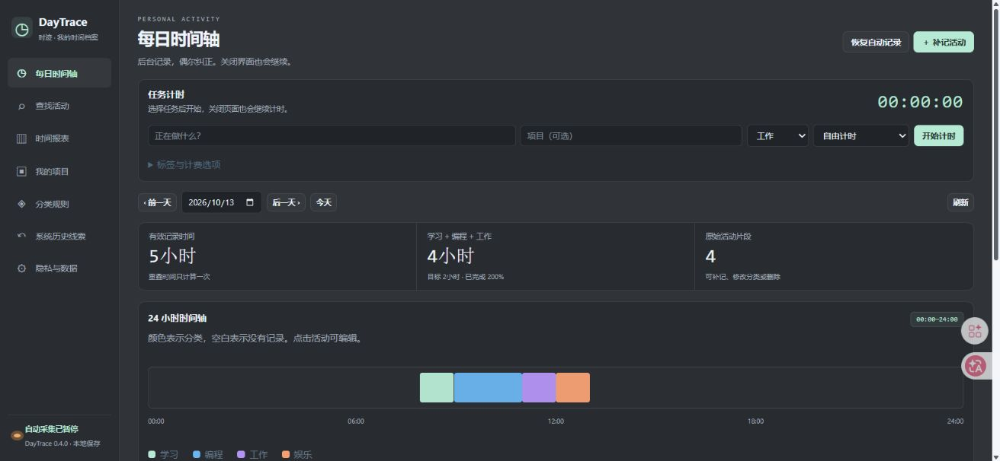

# DayTrace · 时迹

**不用每天打开，回顾电脑上的一天。**

DayTrace 是面向 Windows 的本地个人时间记录软件。登录后在后台采集应用与离开电脑时间，想查看时打开一个 **360 × 460 的小面板**；详细时间轴、报表和数据管理按需展开。

v0.4 使用深灰表面、薄边框、浅绿强调色和紧凑数字排版，视觉参考 Token Monitor 的密度。界面独立实现，没有打包它的代码或图标。



> 图中为合成演示记录；默认入口是小型原生桌面面板，图中是按需打开的详细界面。

## 下载与开始使用

1. 在 [Releases](https://github.com/st-cx/DayTrace/releases) 下载 `DayTrace-v0.4.0-Windows-x64.zip`。
2. 解压整个文件夹。保留 `DayTrace.exe` 和同目录的 `_internal`，双击 `DayTrace.exe` 即可使用，无需安装 Python。
3. 小面板内点击“设置”，勾选“登录 Windows 时启动”并保存。之后登录 Windows 会静默记录，不会弹出窗口。
4. 小面板查看今日记录、前三类时间分配及最近活动，可以暂停、开始或结束任务。详细界面可补记屏幕外活动并调整分类。

**关闭面板或浏览器不会停止后台记录。** 需要停止时，在“隐私与数据”点击“退出软件”，或运行 `DayTrace.exe stop`。再次双击即可打开。

Windows 10 / 11 x64；建议使用仍受系统厂商支持的系统版本。软件无需管理员权限。Linux/macOS 的自动采集尚未实现。

## 已有功能

| 需求 | 行为 |
|---|---|
| 自动记录电脑活动 | 记录前台应用与键鼠空闲状态；不记录按键内容 |
| 自动判断用途 | 常见开发、阅读、办公、影音、游戏与待办软件按基本用途归类 |
| 只做个别纠正 | 编辑自动活动时可只改本条，或记住准确的应用名；自定义规则优先于应用记忆 |
| 一天的回顾 | 每日时间轴、分类分配、查找、日期范围报表、项目与标签；重叠时间只计算一次 |
| 屏幕以外的活动 | 手动补记上课、运动、午饭等 |
| 任务计时 | 自由计时与25分钟专注；正常退出或异常重启后提供从当前时间继续/放弃继续的选择 |
| 停机保护 | 已保存片段保留；重启、睡眠及采样中断间隔不会补算为工作时间 |
| 导入与导出 | DayTrace JSON/CSV、本人的Clockify详细CSV、Toggl 2.0（Focus）时间日志CSV；重复跳过、坏行整份拒绝 |
| 本机备份 | JSON备份包括记录、项目、规则及应用分类记忆 |

浏览器、AI和通讯软件可以用于多种事情，基础识别不会代替你判断具体任务。仅凭应用名无法知道你在浏览器里学习还是娱乐。

## 安装之前的记录能恢复吗？

**部分系统线索可以，完整的过去应用使用时长不保证能补回。**

“系统历史线索”只读扫描 Windows 已留存的近30天开关机日志、可读取的应用最近执行线索和近期文件快捷方式。日志被清理或未留存时，软件会显示为空；读取受限时会说明原因，不提升到管理员、不绕过权限。

- 开关机区间可能包含睡眠、待机和无人操作，**不等于有效使用时间**。
- 应用最近执行时间只有一个线索，不能推算用了多久；近期文件更新时间也不是阅读时长。
- 缺少关机事件的区间不补算时长。历史线索独立展示，**不会变成工作、学习或计费记录**。
- 要得到之后可靠的应用时间，后台采集进程必须运行；开启登录启动后无需手动开界面。进程彻底退出后无法继续采集。
- 已有其他记录器导出的记录，可通过支持的CSV导入；这是已有记录的迁入，不是从Windows凭空还原。

开关机事件依据 [Microsoft 的事件日志说明](https://learn.microsoft.com/en-us/troubleshoot/windows-server/performance/troubleshoot-unexpected-reboots-system-event-logs)；近期文件的留存范围见 [SHAddToRecentDocs](https://learn.microsoft.com/en-us/windows/win32/api/shlobj_core/nf-shlobj_core-shaddtorecentdocs)。

## 隐私与数据

所有记录保存在当前用户的 `%LOCALAPPDATA%\DayTrace`，没有云账号和云端上传。

默认不保存窗口标题，不采集网页域名，不截图、不录音、不记录键盘输入。登录启动为可选设置，不授予管理员权限。需要更细的网页分类时，可以自行安装 `browser-extension` 并启用域名采集；只记录域名，私密浏览不记录。

不要把自己的数据库、JSON备份、日志或扩展密钥上传到仓库。发布包和本仓库不包含个人记录、账号凭据、第三方软件安装包或完整逆向研究目录。应用使用进程只监听 `127.0.0.1`。

CSV导入时先核对日期顺序和时区。Clockify默认日/月/年，Focus默认月/日/年；时间默认本机时区，可填写UTC分钟时差。金额与外部费率不导入，旧版Toggl Track CSV尚未支持。

## 从源码运行与构建

Python 3.10+，带Tk支持；程序运行采用标准库。Windows源码入口：

```powershell
python manage_daytrace.py start               # 紧凑面板 + 后台
python manage_daytrace.py start --background  # 仅后台
python manage_daytrace.py stop                # 停止记录
python manage_daytrace.py status              # 查看状态
```

完整界面地址为 `http://127.0.0.1:41789/`。端口或测试目录可通过 `DAYTRACE_PORT` / `DAYTRACE_HOME` 指定，避免测试污染日常数据库。

运行 `build_windows.bat`，构建使用独立 `.build-venv`，输出 `dist/DayTrace`。脚本不更新全局Python环境。发布运行包使用Python3.13.6、PyInstaller6.22.3，已经包含所需环境。

```powershell
python -m unittest discover -s tests -p "test_*.py"
node --test tests/test_extension.cjs tests/test_timer_recovery_ui.cjs
```

## 验证与当前范围

本版核心测试包含CSV日期/秒数、原数据库兼容、重叠统计、恢复选择、应用记忆、系统线索不写工时、后台启动不弹UI及小面板的实际Tk布局。浏览器扩展与恢复界面另有8项Node检查。独立EXE及详细界面也在隔离数据目录验收。

完整番茄休息循环、任务空闲四分支、原始观测与确认工时分表、复杂定时/驻留规则、拆分合并撤销、云端双向同步、团队审批、发票与移动端尚未实现。实际锁屏/睡眠等全部设备生命周期也未穷尽验收。

DayTrace借鉴ActivityWatch、ManicTime、Clockify与Toggl的产品思路，但**不是这四款软件全部功能的替代品，也不代表它们已经完整逆向**。研究用于理解行为，本仓库为独立实现。

## 常见问题

**关闭窗口后还在运行？** 这是为了持续记录。想完全退出，请使用设置中的“退出软件”。

**看不到安装前的应用时间？** Windows通常没有足够的持续前台记录。本版显示能读取的系统线索，不把缺失信息补成工时。

**历史线索读取失败？** 可以继续使用日常记录。软件不会为此修改日志、注册表权限或请求管理员。

**程序启动失败？** 检查是否完整解压、41789端口是否被其他程序占用，并查看 `%LOCALAPPDATA%\DayTrace\launcher.log`。排查日志时先去掉隐私信息。

**更新后数据在哪里？** 仍在原来的当前用户数据目录。先在软件中备份，退出旧服务，再替换运行包。

## 许可

[MIT](LICENSE)。Python、Tcl/Tk与打包工具的许可见 [第三方说明](THIRD_PARTY_NOTICES.md)。
